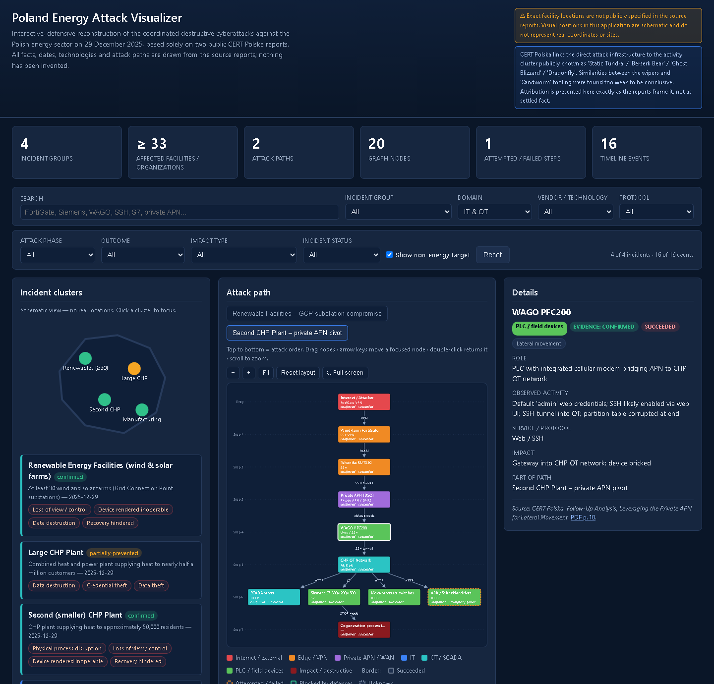
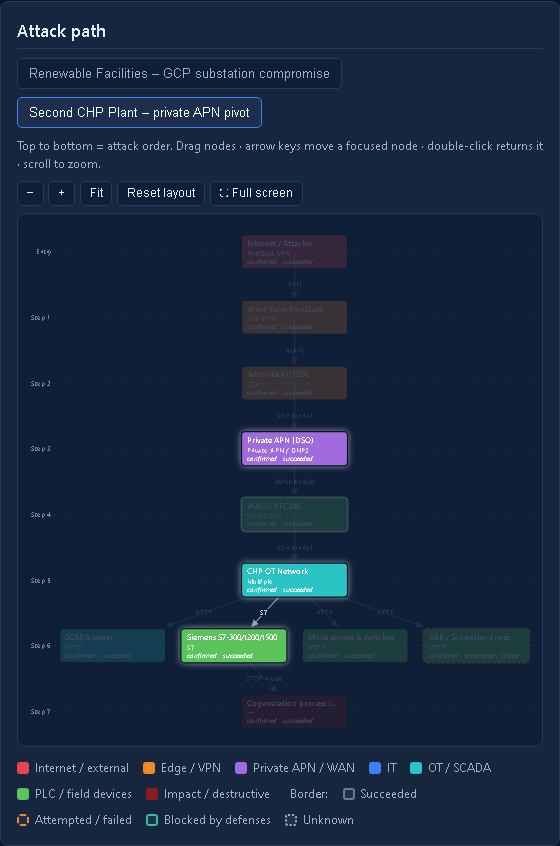
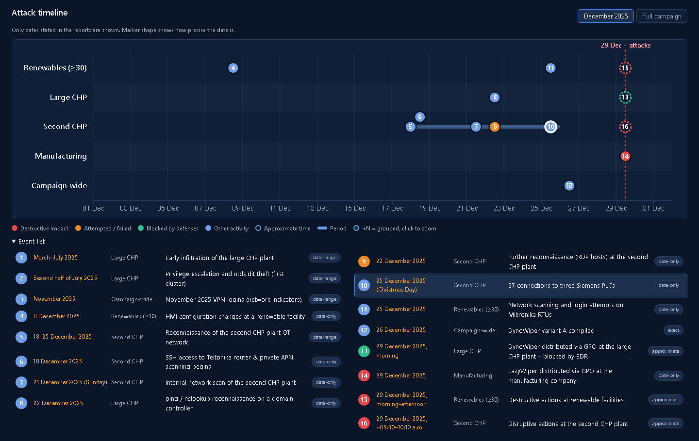

# Poland Energy Attack Visualizer

**An interactive, source-grounded reconstruction of the coordinated cyberattacks on the Polish energy sector of 29 December 2025.**

Wind and solar farms, two combined heat and power (CHP) plants and a manufacturing company were hit on the same day by what CERT Polska concludes was a single threat actor. This app turns CERT Polska's two public reports into something you can explore: who was hit, how the attacker moved, what each step achieved, and when. Every element links to the exact report page it comes from.




---

## Why this exists

The attacks of 29 December 2025 were unusual. They were purely destructive, they hit physical industrial equipment (OT) as well as IT, and one of them reached a CHP plant through a route CERT Polska had never seen before: a distribution system operator's private cellular network (APN). The reports are detailed, but a 46-page PDF and a 19-page follow-up are hard to take in at once.

This visualizer is for OT/ICS security engineers, SOC analysts, students and anyone who wants to understand the incident quickly, without losing track of what is confirmed, what is likely, and what was blocked.

## Features

| | |
|---|---|
| **Attack-path graphs** | Layered graphs, read top to bottom in attack order (Entry → Step 1 → …). Colors show the security zone (Internet, edge/VPN, private APN, IT, OT/SCADA, field devices, impact). Borders show the outcome: succeeded, attempted/failed, blocked or unknown. Drag nodes, move them with the arrow keys, zoom, fit, go full screen. Your layout is kept per path. |
| **Timeline** | One lane per incident with numbered markers, plus a numbered event list. December view (default) or full campaign (March–December 2025); crowded markers are grouped as **+N**, click to zoom in. Bars mark periods, and dashed rings mark approximate times. |
| **Combinable filters** | Search, incident group, IT/OT, vendor/technology, protocol, attack phase, outcome, impact type, incident status and a non-energy toggle. Matching graph nodes light up; everything else dims. |
| **Source on every element** | Each incident, graph node and event shows *"Source: CERT Polska, ‹report›, ‹section›, PDF p. N"*. The page link opens the PDF at that page. |
| **Honest about uncertainty** | Evidence (confirmed / likely) and outcome (succeeded / attempted / blocked / unknown) are kept separate. Attribution is shown exactly as CERT Polska frames it. |
| **No fake geography** | The reports do not name the facilities' locations, so the map is deliberately schematic. Nothing is placed on real coordinates. |

<table>
<tr>
<td width="40%"></td>
<td></td>
</tr>
<tr>
<td><sub>Second CHP plant: path through the DSO's private APN, with the <em>S7</em> protocol filter applied.</sub></td>
<td><sub>December view: one lane per incident, numbered markers that match the event list.</sub></td>
</tr>
</table>

## Quick start

Requires Python 3.12 or newer.

```bash
git clone https://github.com/ProAdmin007/Poland-Energy-Attack-Visualizer-2025-2026.git
cd Poland-Energy-Attack-Visualizer-2025-2026
pip install -r requirements.txt
uvicorn app:app --reload
```

Then open <http://127.0.0.1:8000>.

That's it. No database, no build step, no Docker. D3.js is loaded from a CDN; without it, the graph and timeline fall back to text views.

### The source PDFs

The two CERT Polska reports are **not** included in this repository; they belong to CERT Polska. You don't need them to run the app: without local copies, each page link opens the official PDF on cert.pl at the right page. To keep local copies (needed for source verification), run:

```bash
python tools/fetch_reports.py
```

| Report | Publication | PDF |
|---|---|---|
| Energy Sector Incident Report – 29 December | [cert.pl](https://cert.pl/en/posts/2026/01/incident-report-energy-sector-2025/) | [PDF](https://cert.pl/uploads/docs/CERT_Polska_Energy_Sector_Incident_Report_2025.pdf) |
| Follow-Up Analysis of the 29 December 2025 Energy Sector Incident | [cert.pl](https://cert.pl/en/posts/2026/08/incident-follow-up-report-energy-sector-2025/) | [PDF](https://cert.pl/uploads/docs/CERT_Polska_Energy_Sector_Incident_Follow_up_Report_2025.pdf) |

## How sources are handled

- **Only what the reports say.** No invented times, places, victim names or attack steps. Where the reports say "likely" or "most likely", the app says *likely*.
- **Page numbers are PDF page numbers**, the numbers a PDF viewer shows. The number printed in each report's footer is one lower; hover a page link to see it.
- **Verified automatically.** `tools/verify_sources.py` checks every reference against the PDFs: the cited section heading must appear on the cited page, or up to two pages earlier when a section continues.

```bash
pip install -r requirements-dev.txt
python tools/fetch_reports.py
python tools/verify_sources.py      # -> 49/49 references verified
```

## Architecture

```
├── app.py                 FastAPI: read-only API, PDF route, static frontend
├── data/incidents.json    the whole dataset (single source of truth)
├── static/
│   ├── index.html
│   ├── app.js             vanilla JS + D3 (graph, timeline, filters)
│   └── styles.css
├── tools/
│   ├── fetch_reports.py   download the source PDFs from cert.pl
│   └── verify_sources.py  check every source reference against the PDFs
└── docs/screenshots/
```

- **Backend:** Python, FastAPI, Uvicorn and Pydantic. The dataset is validated at startup, including cross-references (source ids, incident ids, graph edges), so a broken data file stops the server with a readable error instead of rendering wrong content. There are no write endpoints, no database and no authentication.
- **Frontend:** plain HTML, CSS and JavaScript with D3.js v7 from cdnjs (pinned, with SRI). Assets are cache-busted with a content hash.

### API

| Endpoint | Returns |
|---|---|
| `GET /api/health` | `{"status": "ok"}` |
| `GET /api/metadata` | Title, sources, notices |
| `GET /api/incidents` | All incident groups |
| `GET /api/incidents/{id}` | One incident, or 404 as JSON |
| `GET /api/timeline` | All events, sorted chronologically by the server |
| `GET /api/attack-paths` | Nodes and edges of every attack path |
| `GET /api/summary` | Counts computed from the dataset |
| `GET /reports/{source_id}` | Local PDF, or a redirect to the official PDF |

### Data model

`data/incidents.json` holds four top-level keys: `metadata`, `incidents`, `timeline` and `attack_paths`.

- **Incident:** category, facility type, status (`confirmed` / `partially-prevented`), summary, initial access, affected assets, technologies, protocols, actions, impact, impact types, MITRE ATT&CK techniques and source references.
- **Timeline event:** `date` and an optional `date_end` / `time` for sorting, plus `date_label` (as the report words it) and a `precision` of `exact`, `approximate`, `date-only` or `date-range`. It also has a phase, evidence, outcome and source references. Campaign-wide events have `incident_id: null`.
- **Attack-path node:** zone, role, observed activity, service, impact, evidence, outcome, phase and source.

To extend or correct the data, edit the JSON, run `python tools/verify_sources.py` and restart the server. No code changes are needed.

## Limitations

- The app summarizes; the reports remain the authority.
- Two attack paths are drawn as graphs, the renewable-energy facilities and the second CHP plant, because those are the end-to-end chains the reports describe explicitly. The large CHP plant and the manufacturing company appear in the clusters, table, timeline and details.
- Clock times are as printed in the reports and figures; time zones are often not stated and have not been normalized.

## Responsible use

This is a **defensive and educational** visualization. It contains no exploit code, no malware and no credentials. It reproduces no redacted or victim-identifying details, and IP addresses are defanged (`31.172.71[.]5`). For indicators of compromise and detection rules, use the official reports and [mwdb.cert.pl](https://mwdb.cert.pl/).

## Credits

All incident content comes from the analysis by **[CERT Polska](https://cert.pl/en/)** (NASK – National Research Institute). This project is independent and not affiliated with or endorsed by CERT Polska.
